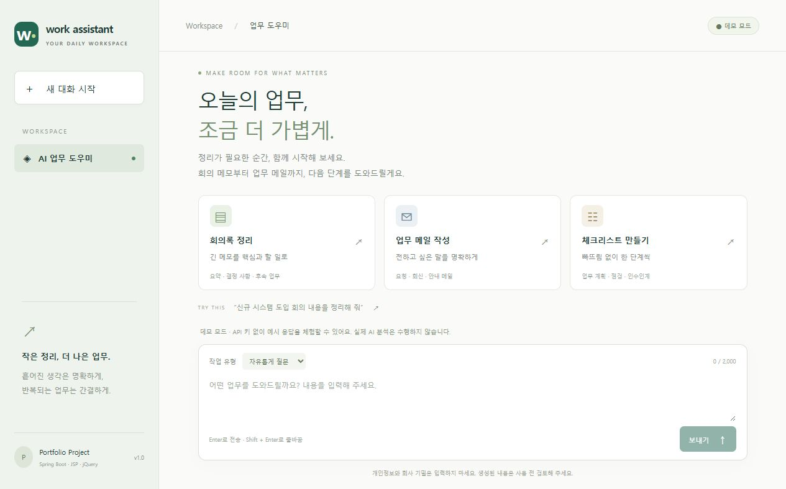

# AI Work Assistant

Spring Boot + JSP + jQuery로 구현한 업무 보조 챗봇 포트폴리오입니다. 회의 메모 정리, 업무 메일 초안, 체크리스트 작성을 하나의 화면에서 시연합니다. 특정 기업의 실제 시스템이나 내부 데이터를 사용하지 않은 개인 프로젝트입니다.

**API 키 없이 바로 실행됩니다.** 기본 데모 모드는 입력을 고정 양식에 배치하며, 실제 AI 생성이나 내용 분석을 수행하지 않습니다. 화면과 응답에 데모 표시가 있습니다.



[채팅 화면](docs/screenshot-chat.jpg) · [모바일 화면](docs/screenshot-mobile.jpg)

## 기술 선택

| 항목 | 선택 |
| --- | --- |
| Java | 21 LTS |
| Spring Boot | 4.1.1 |
| Build | Maven / Wrapper 3.9.11 |
| Server | Spring MVC, 내장 Tomcat, Validation, Lombok |
| View | JSP, Jakarta JSTL, jQuery 3.7.1 (로컬 포함) |
| Packaging | 실행 가능한 WAR |
| AI | 서버에서 OpenAI Responses API 호출 |
| Tests | JUnit 5, AssertJ, 실제 HTTP 서버 및 가짜 AI 서버 |

2026-10-09 [Spring Initializr 메타데이터](https://start.spring.io/metadata/client)를 조회했을 때 안정 버전은 4.1.1, 4.0.8이었으며 기본값 4.1.1을 선택했습니다. 4.2.0 M2와 SNAPSHOT은 제외했습니다. Initializr ZIP은 `4.1.1.RELEASE`를 생성했지만 해당 Maven 좌표는 없었으므로 [Maven Central의 4.1.1](https://repo.maven.apache.org/maven2/org/springframework/boot/spring-boot-starter-parent/4.1.1/)로 수정했습니다. 원본 조회 정보는 `docs/initializr-selection.json`에 있습니다.

Spring Web 선택 시 Boot 4에서는 `spring-boot-starter-webmvc`가 생성됩니다. JSP는 실행 JAR에 제약이 있어 [Spring Boot JSP 안내](https://docs.spring.io/spring-boot/reference/web/servlet.html#web.servlet.embedded-container.jsp-limitations)에 따라 WAR와 `tomcat-embed-jasper`, Jakarta JSTL을 사용합니다. `ServletInitializer`도 포함됩니다. 직접 실행하는 내장 서버를 검증 대상으로 합니다.

## 빠른 실행

JDK 21을 설치하고 `JAVA_HOME`을 JDK 21 폴더로 지정하세요. `java -version`으로 확인합니다. Java 11에서는 실행할 수 없습니다. 별도 Maven 설치는 필요하지 않으며 첫 빌드에는 인터넷이 필요합니다.

프로젝트 폴더에서 Windows PowerShell:

```powershell
.\mvnw.cmd clean verify
java -jar .\target\ai-work-assistant-0.0.1-SNAPSHOT.war
```

macOS / Linux:

```sh
chmod +x mvnw
./mvnw clean verify
java -jar target/ai-work-assistant-0.0.1-SNAPSHOT.war
```

브라우저에서 <http://127.0.0.1:8080>을 엽니다. 서버를 종료하려면 실행 터미널에서 `Ctrl+C`를 누릅니다. 개발 중에는 `./mvnw spring-boot:run` 또는 `.\mvnw.cmd spring-boot:run`을 사용해도 됩니다.

로컬 실행에는 클라우드 서버가 필요하지 않습니다. 데모 모드는 API 비용도 발생하지 않습니다. 프런트엔드 라이브러리와 스타일을 로컬에 포함하여 빌드 이후 화면 확인에 CDN이 필요하지 않습니다.

## 실제 OpenAI 연결

실제 호출에는 API 계정의 사용 가능한 모델과 결제/사용량 설정이 필요합니다. 기본 모델은 [gpt-4.1-mini](https://developers.openai.com/api/docs/models/gpt-4.1-mini)이며 `OPENAI_MODEL`로 변경할 수 있습니다. 실제 API 호출은 비용이 발생할 수 있습니다.

1. 서버를 중지합니다.
2. 서버 프로세스 환경변수에 `OPENAI_API_KEY`를 설정합니다. 소스, JSP, JS, `.env.example`에 키를 넣지 마세요.
3. `APP_AI_MODE=openai`로 설정한 뒤 재실행합니다.

PowerShell에서는 키를 명령 이력에 직접 입력하지 않고 숨김 입력을 사용할 수 있습니다:

```powershell
$secret = Read-Host 'OpenAI API key' -AsSecureString
$env:OPENAI_API_KEY = [System.Net.NetworkCredential]::new('', $secret).Password
$env:APP_AI_MODE = 'openai'
$env:OPENAI_MODEL = 'gpt-4.1-mini'
java -jar .\target\ai-work-assistant-0.0.1-SNAPSHOT.war
# 서버를 종료한 뒤 현재 터미널의 키를 제거합니다.
Remove-Item Env:OPENAI_API_KEY
Remove-Variable secret
```

`openai` 모드에서 키가 없으면 시작을 거부합니다. 오류가 발생해도 데모 응답을 실제 AI 응답처럼 반환하지 않습니다. 기본 `demo` 모드에서는 환경에 키가 있어도 외부 API를 호출하지 않습니다. `.env.example`은 설정 설명용이며 Spring Boot가 `.env`를 자동 로드하지 않습니다.

| 환경변수 | 기본값 | 설명 |
| --- | --- | --- |
| APP_AI_MODE | demo | demo / openai |
| OPENAI_API_KEY | 없음 | 서버 환경변수 전용 |
| OPENAI_MODEL | gpt-4.1-mini | Responses API를 지원하는 사용 가능 모델 |
| PORT | 8080 | 서버 포트 |
| SERVER_ADDRESS | 127.0.0.1 | 기본은 내 PC에서만 접근 |

## 구현 기능

- JSP 초기 렌더링, jQuery AJAX 채팅, 반응형 화면
- 회의록 / 메일 / 체크리스트 예시 입력과 작업별 프롬프트
- 로딩 표시, 중복 전송 방지, 실패한 요청 재시도, 응답 복사
- Enter 전송, Shift+Enter 줄바꿈, 한글 조합 중 전송 방지
- 새 대화 초기화, 최근 대화 최대 10개를 다음 요청에 포함
- 사용자 입력 2,000자 제한 및 서버 Validation
- 연결 제한 5초, AI 요청 제한 30초, 브라우저 제한 35초
- 429 / 인증 오류 / 연결 오류 / 타임아웃 / 빈 응답 / 불완전 응답 / 거절 응답 처리
- 동시 AI 호출 최대 4개, 초과 시 즉시 429 응답. 자동 재시도는 하지 않음
- 출력은 HTML 해석 없이 `.text()`로 표시하고 CSP 등 보안 헤더 적용

## 구조와 데이터 흐름

```text
JSP + jQuery
  → POST /api/chat
  → ChatController (요청 검증)
  → ChatService (업무 흐름)
      → AiGateway
          ├─ DemoAiGateway (로컬 예시)
          └─ OpenAiGateway (서버 → OpenAI)
      → ChatHistoryRepository
          └─ NoOpChatHistoryRepository (저장하지 않음)
```

```text
src/main/java/com/portfolio/workassistant/
  ai/       AI 연결 설정, 데모/실제 어댑터, API 오류
  chat/     Controller, Service, DTO, 도메인, 저장소 인터페이스
  web/      JSP 페이지, 공통 오류 응답, 보안 헤더
src/main/webapp/WEB-INF/views/chat.jsp
src/main/resources/static/{css,js,vendor}/
src/test/java/com/portfolio/workassistant/
```

브라우저 메모리에만 대화를 보관하며 새로고침하면 삭제됩니다. 서버 저장소는 현재 no-op입니다. 화면에 남은 전체 대화 중 최근 메시지 10개만 AI 문맥으로 보냅니다. AI 모드에서는 입력과 최근 문맥이 OpenAI에 전달되며 `store:false`를 사용합니다. 이 옵션은 API 응답의 재조회용 저장을 끄는 설정이며 제공자의 모든 보관을 없앤다는 의미는 아닙니다. [Responses API 텍스트 생성 안내](https://developers.openai.com/api/docs/guides/text)를 참고하세요.

## API

`GET /api/status` → `{"mode":"demo","maxMessageLength":2000,"historyLimit":10}`

`POST /api/chat` (Content-Type: application/json):

```json
{
  "conversationId": "b374ef3a-d5ed-4b4e-8ccb-b0f271520bcb",
  "message": "회의 메모를 정리해 줘. 담당자가 다음 주까지 요구사항을 정리하기로 했어.",
  "task": "MEETING",
  "history": []
}
```

`task`: GENERAL / MEETING / EMAIL / CHECKLIST. `history`: 최대 10개의 `{role, content}`이며 역할은 user / assistant만 허용, 각 내용은 최대 6,000자입니다. `conversationId`는 UUID입니다.

정상 응답 필드: `conversationId`, `messageId`, `answer`, `mode`.

오류 응답 예:

```json
{"code":"AI_TIMEOUT","message":"AI 응답 대기 시간이 초과되었습니다. 잠시 후 다시 시도해 주세요.","requestId":"추적용 UUID"}
```

주요 상태 코드: 400 입력 오류, 422 AI 거절, 429 동시 요청/사용 한도, 502 AI 연결/응답 오류, 503 처리 중단, 504 타임아웃. 공급자 오류 본문, 키, 사용자 입력을 오류 응답이나 애플리케이션 로그에 기록하지 않습니다.

## DB 확장 계획

1. Spring Data JPA 및 원하는 DB 드라이버를 추가하고 `ChatHistoryRepository`의 JPA 어댑터를 구현합니다. no-op 빈은 제거하거나 프로필로 분리합니다.
2. Conversation(id, userId, title, createdAt), Message(id, conversationId, role, content, createdAt) 테이블과 마이그레이션을 추가합니다.
3. 로그인과 대화 소유권 검증 후 서버에서 문맥을 읽도록 변경합니다. 현재 클라이언트 conversationId나 history는 인증 정보로 신뢰하면 안 됩니다.
4. AI 호출 동안 DB 트랜잭션을 열지 않도록, 응답 완료 후 별도 저장 트랜잭션을 사용합니다. 저장 실패와 외부 호출 성공을 구분하고 재시도 멱등성을 설계합니다.
5. 목록/조회/삭제 API, 보관 기간, 사용자별 삭제 정책을 추가합니다.

현재 구현에 DB 영속화, 로그인, 문서 검색(RAG), 스트리밍은 포함되지 않습니다. 이 기능을 구현 완료로 소개하지 마세요.

## 검증 및 시연

`./mvnw verify`는 API 키 없이 동작합니다. 실제 Tomcat의 JSP 렌더링/HTTP API와 로컬 가짜 OpenAI HTTP 서버로 테스트합니다. 자세한 실제 검증 결과는 [검증 기록](docs/VERIFICATION.md)에 있습니다. GitHub Actions도 동일한 데모 테스트를 실행하도록 설정했습니다.

추천 시연 순서:

1. 첫 화면의 데모 배지와 기술 구성을 설명합니다.
2. ‘회의록 정리’를 눌러 가상 데이터를 불러온 뒤 전송합니다.
3. 응답 복사와 ‘새 대화 시작’을 보여줍니다.
4. Controller → Service → Gateway 흐름과 Repository 확장 지점을 설명합니다.
5. 실제 AI 연동은 환경변수 전환 방식이며, 실제 호출을 검증했는지는 별도로 밝힙니다.

## GitHub 공개 및 운영 범위

`.gitignore`에 `.env*`(예시 제외), 키 파일, 로컬 설정, 로그, 빌드 결과를 제외했습니다. 실제 키를 저장한 적이 없는 상태로 제공합니다. `.gitignore`는 이미 추적한 파일이나 Git 이력에 남은 비밀정보를 제거하지 않습니다. 커밋 전에 `git diff --cached`와 업로드 파일을 확인하고 GitHub Secret Scanning / Push Protection을 사용하세요. 노출된 키는 파일만 지우지 말고 폐기·재발급해야 합니다.

이 MVP는 개인 로컬 시연용입니다. 인터넷 공개 전 인증, 사용자별 호출 제한, 비용 한도, 요청 크기 제한, HTTPS, 접근 로그/보관 정책을 추가해야 합니다. 현재 동시 호출 제한은 사용자별 요금 제한이 아닙니다. 회사 문서 대신 가상 데이터를 사용하세요. GitHub에 소스를 공개하는 것과 유료 AI 서버를 공개하는 것은 별개입니다.

## 문제 해결

- Java 버전 오류: `JAVA_HOME`과 PATH의 `java`가 JDK 21인지 확인합니다.
- 8080 사용 중: `$env:PORT='8081'`을 설정한 뒤 다시 실행합니다.
- JSP 404: JAR로 바꾸지 말고 제공된 WAR를 빌드/실행하세요.
- AI 연결 설정 오류: 키/계정 권한/모델을 확인하세요. 키를 채팅이나 스크린샷으로 공유하지 마세요.
- Maven 다운로드 실패: 네트워크/프록시/인증서 환경을 확인하세요. 이미 설치된 Maven 3.9+의 `mvn verify`로도 빌드할 수 있습니다.

## 오픈소스 고지

jQuery 3.7.1은 MIT 라이선스입니다. `src/main/resources/static/vendor/jquery-LICENSE.txt`에 고지를 포함했습니다. Spring과 기타 라이브러리의 라이선스는 각 배포물을 따릅니다.
# spring-ai-work-assistant

